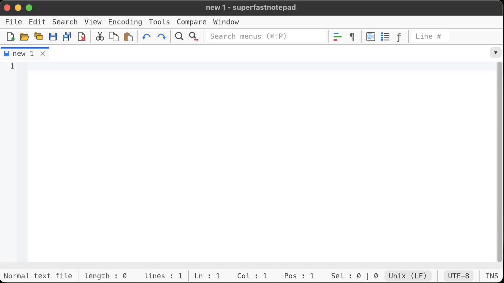

# superfastnotepad

A fast text and source-code editor written in **pure Rust**. Runs natively on **Windows**
(x86_64) and **macOS** (Apple Silicon and Intel), and is drawn on the GPU for smooth scrolling.



Language definitions, colour themes and Function List rules are plain JSON files in `assets/`,
embedded in the binary at build time.

## Download

Builds for Windows (64-bit) and macOS (Apple Silicon) are on the
[Releases](https://github.com/darshan5/superfastnotepad/releases) page. They're made by the
`Release` workflow in `.github/workflows/release.yml`, which tags a version and drafts a release.

| File | What it is |
|---|---|
| `superfastnotepad-vX.Y.Z-windows-x64-setup.exe` | Windows installer (per user, no admin): the app and `superfastnotepad-cli.exe`, Start menu, "Open with", PATH (optional). `/S` installs silently |
| `superfastnotepad-vX.Y.Z-windows-x64.exe` | The Windows app on its own |
| `superfastnotepad-cli-vX.Y.Z-windows-x64.exe` | The [command line tools](#command-line-tools-for-scripts-and-ai-agents) on their own, a console program for scripts and AI agents |
| `superfastnotepad-vX.Y.Z-macos-apple-silicon.dmg` | The macOS app; the CLI is `superfastnotepad.app/Contents/MacOS/superfastnotepad-cli` |

## Build

```sh
cargo build --release            # target/release/superfastnotepad(.exe) and superfastnotepad-cli(.exe)
cargo test                       # unit tests (lexer, search, ops, encodings, ...)
```

- **macOS (Apple Silicon):** `cargo build --release --target aarch64-apple-darwin`, or
  `scripts/bundle-macos.sh` to build `target/aarch64-apple-darwin/release/superfastnotepad.app`
  (icon from `scripts/make-icon.py`, ad-hoc signed; pass `x86_64-apple-darwin` for Intel)
- **Windows:** `cargo build --release --target x86_64-pc-windows-msvc` (build it on Windows; on a
  Mac you can type-check it with `cargo check --target x86_64-pc-windows-msvc`)

The release build uses the GUI subsystem on Windows, so no console window opens. The `.exe` carries
the app icon and version details (`assets/windows/app.ico`, from `scripts/make-icon.py --ico`).

## Features

| Area | What's implemented |
|---|---|
| **Editing** | Rope buffer, undo/redo with typing merge, multi-caret (Ctrl/⌘+click), column selection (Alt+drag, Alt+Shift+arrows), column paste, overtype, auto-indent, smart Home, auto-close brackets/quotes, word and keyword completion (names the file declares first; members after `.`), call tips with the parameter under the caret underlined |
| **View** | Syntax highlighting for 26 languages plus log files (off by default; toolbar button or View > Syntax Highlighting, or on at every start with Settings > Editing; colours the rest of the file in the background), font size (⌘/Ctrl + and −, View > Font Size), line numbers, bookmarks, change history, folding, word wrap, whitespace and line-ending symbols, indent guides, brace matching, split view, full screen, post-it, always on top |
| **File** | Open/save/save as/save a copy, reload, rename, recent files, sessions (with `--session-dir` for separate workspaces), unsaved-content backups every 3 s when something changed, window position restored, change detection on disk, drag and drop, single instance, File > New Window, move any tab (saved or not) to a new window, File > Print (⌘/Ctrl+P: the selection or the whole document, with syntax colours, line numbers, header and footer; macOS print panel with preview and Save as PDF, Windows Print dialog) |
| **Encoding** | Language, ANSI (Windows-1252), UTF-8, UTF-8-BOM, UTF-16 LE/BE BOM (reinterpret or convert), automatic detection from a sample, Windows/Unix/Mac line endings with a "Mixed" indicator in the status bar |
| **Edit** | Cut/copy/paste, selection tools, line operations, 16 sort modes, case conversions, comments, whitespace tools, Column Editor, insert date/time or a UUID, redact |
| **Search** | Find/Replace/Find in Files (background), Mark, Normal/Extended/Regex modes, Find All results panel, incremental search, Filter Lines (show only matching lines, or hide them; export to a new tab), Go to Line (also a box on the toolbar), highlight tokens in 5 styles, bookmarks. The Find dialog can float or dock at the bottom. Search Menus (⌘/Ctrl+Shift+P, box on the toolbar) finds any menu command by name |
| **Panels** | Function List (20 languages, background scan), JSON Tree (jump to source, copy JSON pointer/key/value), Document Map (with compare markers), Document List, Workspace, Character Panel, Clipboard History; duplicate, rename or move files to the Trash from the Workspace, Document List or All Open Documents |
| **Compare** | Side by side with aligned spacer rows, or inline in one pane. Added/removed/changed/moved lines and changed words, scrollbar and Document Map markers. Compare two views, a tab with the next, selected lines, the clipboard, the last save, or a blank Original/Changed pair. Ignore whitespace, case or empty lines; swap sides; copy one or all differences left/right; side panels hidden while comparing |
| **Tools** | Format: JSON, XML, HTML, CSS, JavaScript/TypeScript, Markdown (pretty print; minify for JSON/XML/CSS). Encode/Decode: Base64, URL, Quoted-printable. Data: CSV↔JSON, CSV↔TSV. Hash: MD5, SHA-1, SHA-256, SHA-512. Date and Unix Time: live clock, date picker to Unix time and back. Color Picker: saturation/brightness square, hue strip, RGB/hex/CMYK, eyedropper for any pixel on screen; inserts `#RRGGBB`. Password Generator: 4–64 characters from the OS secure random source, optional numbers and symbols |
| **Other** | Six built-in themes (Light, Dark, Midnight, Paper, Forest, and OCR Optimized: black on white for screenshots read by OCR) that can follow the OS light/dark setting, one Settings window (general, appearance, editing, new documents, completion, files, formatting, printing, keyboard shortcuts), tab colours and pinning, a monthly update check (File > Update Available when there's a newer release; can be turned off or run by hand in Settings > General), a searchable list of all tabs at the end of the tab bar, a tab menu with Open in Finder/Explorer, Terminal, the default app or the default browser |

Command line: `superfastnotepad [-multiInst] [-nosession] [--session-dir <folder>] [-ro] [-alwaysOnTop] [-l<lang>] [-n<line>] [-c<col>] [--font-size <pt>] [--theme <name>] [--large-results] [--high-contrast-results] [--wrap-results] [files or folders...]`

The display options apply to that run only (they aren't saved): they change the same settings as
View > Font Size and Settings > Appearance > Search results, but the saved values stay as they
were unless you change one by hand while the app runs. `--no-large-results` etc. turn them off.
`--theme <name>` (case and `-` don't matter: `--theme ocr-optimized`) shows a theme for that
run too, until one is picked in Settings. Sent to a running window, these options apply there.

For screenshots read by OCR (AI agents driving a remote machine):
`superfastnotepad --theme "OCR Optimized" --font-size 18 --large-results --wrap-results`.
OCR Optimized is black on white with no italics, every text colour at 7:1 contrast or more,
menus, dialogs and search results in full black, and a solid (not see-through) Find window.

## Command line tools (for scripts and AI agents)

`superfastnotepad-cli` runs headless commands: no window, results on stdout (or in `--out <file>`,
UTF-8), exit code 0 = done or found, 1 = nothing found / invalid / different (for `diff`: the
files differ), 2 = error. On **Windows** it's its own console program (`superfastnotepad-cli.exe`,
installed next to the app). On **macOS** use
`superfastnotepad.app/Contents/MacOS/superfastnotepad-cli`, or give the app itself the command
(`superfastnotepad tail app.log`). `superfastnotepad-cli help` lists the commands, and
`superfastnotepad-cli <command> --help` the options of one.

| Command | What it does |
|---|---|
| `search` | Find text or a regex in files: `path:line: text`, `--context`, `--fields` (CSV hits as `column: value`), `--newest`, `--format json` |
| `tail` / `head` | Last / first lines; `tail --follow` prints new lines, `--until <regex>` stops at a matching line, `--timeout`; `--grep`, `--numbers` |
| `lines` | A range with line numbers: `lines app.log 120-160`, `120-` (to the end), `-40` (from the start), `--around 1234 --context 10` (around a `search` hit); with no end it prints 50 lines and says which range comes next |
| `append` / `write` | Add to / create a file from `--text`, `--from <file>` or a pipe, keeping its encoding and line endings; `write` needs `--force` to replace |
| `replace` | Find and replace in files or a folder (`--dir --glob -r`), `$1` groups, `--dry-run` (unified diff), `--backup` |
| `info` | Size, date, encoding, line endings (or Mixed), line count, longest line |
| `convert` | Change encoding (`utf-8`, `utf-8-bom`, `utf-16le`, `utf-16be`, `ansi`) and line endings (`crlf`, `lf`, `cr`) |
| `diff` | Unified diff of two files; `-i`, `-w` |
| `files` | Files by `--glob` and date, newest first, with sizes |
| `format` / `minify` / `validate` | JSON, XML, HTML, CSS, JavaScript/TypeScript, Markdown (pretty print); minify JSON, XML, CSS; validate JSON, XML, CSV, TSV (error with line and column); `--in-place` |
| `data` | CSV ↔ JSON ↔ TSV |
| `base64` / `url` / `qp` | `encode` or `decode` (Base64 also for binary files, `--url-safe`) |
| `hash` | MD5, SHA-1, SHA-256 (default), SHA-512 or `--algo all`; `--check <hex>` |
| `password` | `--length`, `--count`, `--no-upper/--no-lower/--no-numbers/--no-symbols`, `--symbols "-_."`, `--no-ambiguous`, `--exclude` |
| `time` | Unix seconds/ms ↔ UTC ↔ local time: `time`, `time 1700000000`, `time "2026-11-25 09:00" --utc` |
| `uuid` | Random version 4 UUIDs |

```
superfastnotepad-cli search --dir C:\logs --glob "export-*.txt" --regex "^46411," --fields --out C:\temp\hits.txt
superfastnotepad-cli lines C:\logs\export-1.txt --around 1234 --context 5
superfastnotepad-cli tail C:\logs\app.log --follow --until "Export finished" --timeout 600
superfastnotepad-cli replace --dir C:\app\conf --glob "*.ini" --text "Server=old" --with "Server=new" --dry-run
superfastnotepad-cli convert C:\temp\out.csv --encoding utf-8 --eol crlf
superfastnotepad-cli format C:\temp\response.json --out C:\temp\pretty.json
superfastnotepad-cli time 1764075600
```

- Text comes from `--text "..."`, a file argument, or a pipe (`type x.json | superfastnotepad-cli format`).
  `--escapes` makes `\n`, `\t` and `\\` in `--text` a new line, a tab and a backslash.
- Commands that change files (`append`, `write`, `replace`, `convert`, `format --in-place`) refuse
  a file that's open in superfastnotepad with unsaved changes (`--force` overrides), and
  `--backup` keeps `<file>.bak`.
- The app's own program takes the same commands (`superfastnotepad tail ...`). To open a file
  whose name is a command, write `./tail`. On Windows the app is a GUI program, so cmd and
  PowerShell don't wait for it: use `superfastnotepad-cli` from scripts.

### For AI agents on Windows (cmd, PowerShell, Run box)

`superfastnotepad-cli.exe` is a console program: cmd and PowerShell wait for it, its output can
be piped, and `%ERRORLEVEL%` / `$LASTEXITCODE` hold its exit code. The installer puts it in
`%LOCALAPPDATA%\Programs\superfastnotepad\` and, with "Add to PATH" (on by default), on the PATH
of windows opened after installing. Without PATH, use the full path:

| Shell | Command |
|---|---|
| cmd | `"%LOCALAPPDATA%\Programs\superfastnotepad\superfastnotepad-cli.exe" search --dir C:\logs --text "error" --out C:\temp\hits.txt` |
| PowerShell | `& "$env:LOCALAPPDATA\Programs\superfastnotepad\superfastnotepad-cli.exe" search --dir C:\logs --regex '^46411,' --out C:\temp\hits.txt` |
| Run box (Win+R) | `cmd /c superfastnotepad-cli search --dir C:\logs --text error --out C:\temp\hits.txt` |

- Prefer `--out <file>` and read the file back: it's UTF-8 in every shell, while Windows
  PowerShell 5.1's `>` rewrites output as UTF-16.
- PowerShell: put a quoted program path after `&`; quote regexes with single quotes (`$` and
  backtick are special inside double quotes); `%` and `^` need no escaping there, but do in cmd.
- In cmd, `%NAME%` expands even inside quotes: write `%%` in a .bat file for a literal `%`.
- The installer also registers App Paths, so `start superfastnotepad-cli ...` and
  `Start-Process superfastnotepad -ArgumentList ...` find either program without PATH.
- To open a file in the app for screenshots: `start "" superfastnotepad --theme "OCR Optimized" --font-size 18 C:\logs\app.log`
  (`start` returns at once; the app is a window, not a console program).

Settings, session and backups are stored in the OS config dir (for example
`~/Library/Application Support/org.superfastnotepad.superfastnotepad` on macOS,
`%APPDATA%\superfastnotepad` on Windows). Set `SUPERFASTNOTEPAD_CONFIG_DIR` to override it, and
`SUPERFASTNOTEPAD_PROFILE=1` to print frame timings to stderr.

See [docs/ROADMAP.md](docs/ROADMAP.md) for performance measurements, the performance plan and
features that aren't built yet, and [TODO.md](TODO.md) for planned compare features.

## Limitations

- **Fonts:** the editor and the UI use one font: the built-in system monospace font (Menlo on
  macOS, Consolas on Windows) or one picked in Settings > Appearance (installed monospace fonts,
  or any .ttf/.otf/.ttc file). The built-in font fills in characters a picked font lacks, but
  characters neither has (for example Chinese, Japanese, Korean) show as empty boxes. The editor
  gives every character the same width, so proportional fonts don't line up.
- **Highlighting** uses one generic, data-driven lexer for all languages. Embedded JS/CSS in HTML
  and PHP blocks are handled; very language-specific constructs (for example Perl heredocs) are
  highlighted more simply.
- No macros, plugins, user-defined languages, translations, auto-updater, shortcut
  remapping, spell check, or right-to-left text.

## Source layout

```
src/
  main.rs           startup, CLI args, font (one system monospace face), single-instance
  cli.rs            headless commands: dispatch, options, input/output (cli_search.rs,
                    cli_files.rs, cli_tools.rs); bin/superfastnotepad-cli.rs is the console program
  app.rs            state + command dispatch
  ui.rs             menus, toolbar, tab bars, split views, status bar
  editor.rs         the editor widget
  ops.rs            editing operations on document + selections
  document.rs       rope buffer, undo, line metadata, folds, lex cache
  lexer.rs          generic incremental lexer
  langs.rs/theme.rs language and theme loading (assets/*.json)
  search.rs         find/replace/find-in-files engine
  function_list.rs  Function List engine (assets/function_lists.json)
  textops.rs        pure text transforms (sort, case, trim, hashes, ...)
  formatters.rs     MIME tools + JSON/XML formatters
  formatters_web.rs HTML/CSS/JS/TS/Markdown formatters
  datatools.rs      CSV/TSV/JSON conversion, UUID, timestamps
  json_tree.rs      JSON tree parser (offsets, JSON pointers)
  filter.rs         Filter Lines
  calltip.rs        call tips from the file's own definitions
  colorpick.rs      color picker and eyedropper
  password.rs       password generator
  update.rs         update checker (latest GitHub release)
  compare.rs        diff engine (alignment, word-level changes, moved lines)
  compare_ui.rs     compare session: panes, navigation, copy left/right
  encoding.rs       encoding detection and conversion
  dialogs.rs panels.rs icons.rs config.rs platform.rs commands.rs
```

## Related projects

Other fast native Rust apps by the same author, built the same way for AI agents: each has a
console `-cli` program for Windows (in the installer and as its own `.exe`), headless commands
with `--json` output and exit codes, and the same notes for cmd and PowerShell.

- **[OpenViSQL](https://github.com/darshan5/openvisql)**: a desktop SQL client for MySQL, MariaDB,
  PostgreSQL and SQLite. `openvisql-cli` runs SQL against a saved connection or from flags and
  prints the results as a table, records, CSV, TSV, JSON or Markdown; saved queries with
  parameters (`--snippet "Order lines" --param order=1042`); `--read-only`.
- **[SuperFastImageView](https://github.com/darshan5/superfastimageview)**: an image viewer that
  puts the first image on screen in about 100 ms, with basic editing and batch conversion.
  `superfastimageview-cli` gets image `info` (size, format, metadata), and can `convert`,
  `resize` (e.g. `--max 1568` for a model's vision input), `rotate` (lossless JPEG), `flip`,
  `strip` metadata and `compress` to a target size, with `--dry-run`.

License: [MIT](LICENSE).
